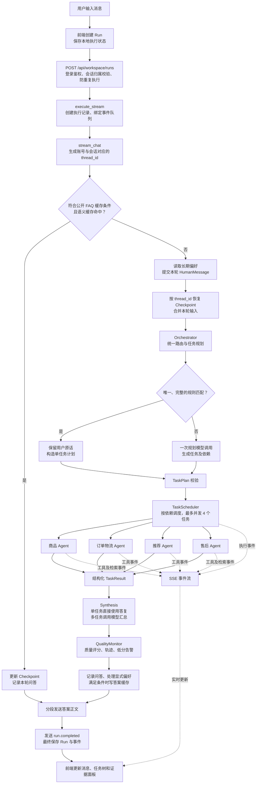
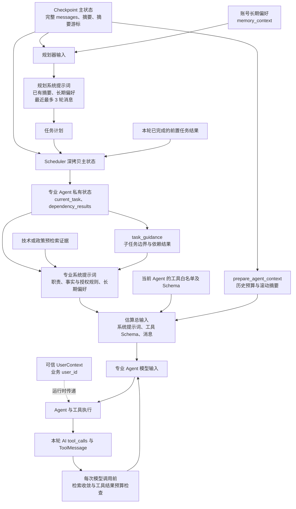
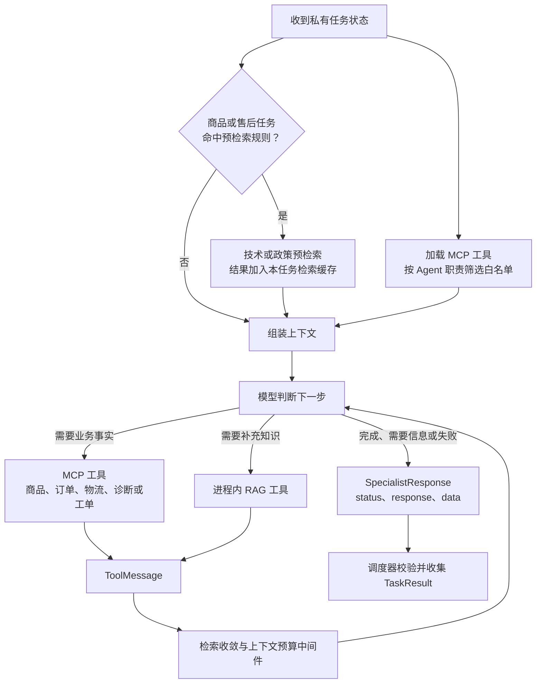
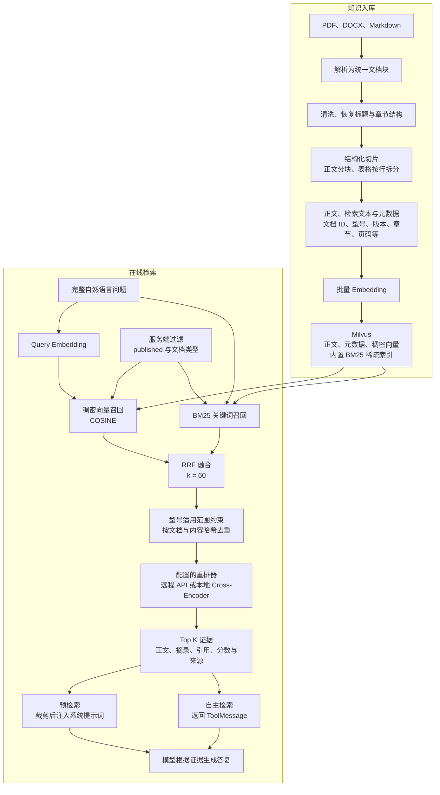

# Support Agent · 智能客服

面向数码商城的多智能体客服系统，基于 FastAPI、LangGraph 和 LangChain，提供商品咨询、选购推荐、订单物流与售后服务。React 三栏工作台展示会话、答复、任务执行轨迹和检索证据。

本文描述当前代码中的消息处理、任务编排、上下文组装与 RAG 流程。参数注明为代码默认值，实际运行以配置为准。

## 消息到答复的总流程



LangGraph 主图节点顺序固定为：

```text
START → orchestrator → task_scheduler → synthesis → quality_monitor → END
```

语义缓存命中在进入主图前返回。计划校验失败时，调度器跳过执行，由汇总节点给出澄清提示。

| 阶段 | 当前行为 | 主要产物 |
| --- | --- | --- |
| 前端发送 | 创建 run_id，提交 conversation_id 与 query，消费 SSE | 本地 Run 与执行状态 |
| 后端接入 | 校验登录、会话归属、重复 Run，以及会话是否正在执行 | 合法执行请求 |
| 缓存判断 | 仅对筛选后的公开、稳定 FAQ 查询语义缓存 | 缓存答案或进入图执行 |
| 恢复状态 | 恢复完整历史与滚动摘要，追加本轮用户消息 | AgentState |
| 统一规划 | 严格规则直达，否则一次模型调用识别意图、拆任务、建依赖 | tasks |
| 计划校验 | 最多 8 个任务，检查 Agent、唯一 ID、查询、依赖存在性与无环性 | 可执行任务计划 |
| 任务调度 | 无依赖任务并行，有依赖任务等待前置任务完成 | 每个任务的私有状态 |
| 专业执行 | 加载工具、预检索、组装上下文，运行模型与工具循环 | SpecialistResponse |
| 结果汇总 | 单任务直接采用答复，多任务模型汇总，汇总失败按任务拼接兜底 | 最终 AI 消息 |
| 质量记录 | 评估路由、工具和答复，记录轨迹与告警 | metadata.quality |
| 保存与返回 | 保存问答，处理偏好，按条件写缓存，发送正文及完成事件 | 用户答复与执行记录 |

入口代码：[前端执行控制](frontend/src/features/execution/services/runController.ts)、[Workspace 接口](app/router/workspace.py)、[SSE 桥接](app/service/workspace_stream.py)、[会话服务](app/service/chat_service.py)、[主图](agent/core/workflow/graph_manager.py)。

## 路由与任务调度

### 统一规划入口

规则关键词只产生候选 Agent；唯一候选还必须命中完整句式才能直达。条件、否定、复合请求、歧义或未覆盖句式进入模型规划。规则直达保留完整用户原话，不抽取业务参数，同样经过计划校验、调度和汇总。

规划模型使用规划系统提示词、已有会话摘要、长期偏好和最近最多 3 轮消息，生成单任务或多任务计划。一次规划模型调用指正常业务路径；底层模型适配器仍可按配置重试瞬时错误或切换备用模型。

```json
{
  "tasks": [
    {
      "task_id": "t1",
      "agent_name": "order_agent",
      "query": "查询用户本轮指定的订单",
      "depends_on": []
    },
    {
      "task_id": "t2",
      "agent_name": "after_sales_agent",
      "query": "根据订单确认设备型号，解释用户描述的红灯状态",
      "depends_on": ["t1"]
    }
  ]
}
```

以上为依赖关系示例，不代表每次请求都会生成这份计划。实际子任务保留用户条件、限制和精确标识；缺少参数但领域明确时，由专业 Agent 追问。规划器不能虚构用户对写操作的授权。

### 调度与状态隔离

调度器按依赖执行，默认最多并发 4 个任务。每次调用专业 Agent 前深拷贝主状态，加入 current_task 与本轮前置任务的 dependency_results，并清空该私有视图中的执行元数据和任务结果。

专业 Agent 返回 status、response、data，调度器验证结构化结果后统一提交 task_results。子 Agent 的内部工具消息和中间回答不会追加到主图共享会话；Synthesis 最终写入一条用户可见答复。调度器同时合并返回的会话摘要与摘要游标。

| 状态 | 含义 | 对依赖任务的影响 |
| --- | --- | --- |
| completed | 当前子任务已完成 | 下游可以启动 |
| needs_input | 缺少必要信息，需要用户补充 | 下游标记为 blocked |
| failed | 当前子任务执行失败 | 下游标记为 blocked |
| blocked | 前置事项未完成，当前子任务未执行 | 继续阻塞依赖该任务的下游 |

一个分支失败不阻止独立任务继续执行。取消请求时，调度器取消并清理尚未结束的子任务。

实现：[统一规划](agent/agents/orchestrator.py)、[路由规则](agent/core/routing/rules.py)、[任务契约](agent/core/workflow/tasks.py)、[任务调度](agent/core/workflow/scheduler.py)、[结果汇总](agent/core/workflow/synthesis.py)。

## 上下文组装

持久化主状态、规划器输入、专业 Agent 输入分别承担状态保存、需求规划和任务执行。



| 上下文 | 来源 | 组装方式与用途 |
| --- | --- | --- |
| 完整历史 | Checkpoint 的 messages | 长期保留，模型使用预算处理后的视图 |
| 最近对话 | 共享历史 | 规划器看最多 3 轮，专业 Agent 按预算选择 |
| 滚动摘要 | conversation_summary | 规划器提示词中使用；专业 Agent 以摘要系统消息使用 |
| 长期偏好 | MySQL 偏好表 | 注入规划器和专业 Agent 的系统提示词 |
| 当前子任务 | current_task | 经 task_guidance 注入专业系统提示词 |
| 本轮依赖结果 | dependency_results | 注入任务提示词，作为有来源的业务数据 |
| 预检索证据 | 技术或政策检索 | 裁剪后注入专业系统提示词 |
| 自主检索与业务工具结果 | 本轮工具调用 | 作为 ToolMessage 加入内部消息序列 |
| 工具定义 | Agent 工具白名单 | 作为工具 Schema 提供给模型，同时计入预算 |
| 可信身份 | 应用生成的 UserContext | 运行时传递，拦截器覆盖私有工具的 user_id |

专业 Agent 可以看到其他 Agent 的历史最终答复，用于理解指代和背景；当前任务执行状态与内部工具过程独立。历史动态业务信息需要本轮重新核验，本轮已完成的依赖结果可以供后续任务使用，并保留来源。

### 历史压缩与工具结果预算

- 总输入预算默认为 **100,000 个估算 token**，包含系统提示词、工具 Schema 和消息；这是保守估算，不依赖供应商 tokenizer。
- 预算内使用“已有摘要 + 尚未摘要的历史”。超预算时增量更新较早历史摘要，摘要最多 **1,000 字符**，优先保留最近 **20 轮**完整对话。
- 仍超预算时继续移除最旧完整轮次，保留当前用户轮；无法压到预算内时记录 budget_overflow。
- 摘要更新失败时保留游标供后续重试，主链路继续使用近期历史。
- 每次内部模型调用前再次估算输入：先清理较早工具结果，再按预算保留最新大结果的头尾，并加入截断标记。
- 历史压缩和工具结果裁剪修改模型输入视图，原始共享历史仍保留。

实现：[历史预算与滚动摘要](agent/core/memory/context_window.py)、[专业调用入口](agent/core/observability/execution.py)、[共享历史来源规则](agent/core/workflow/prompting.py)、[工具结果预算](agent/core/memory/tool_context.py)、[身份注入](agent/core/security/user_context.py)。

## 专业 Agent 执行循环



| 主图中的 Agent | 职责与工具 |
| --- | --- |
| product_agent | 商品目录、结构化规格、价格库存、SKU 对比、技术文档 RAG |
| order_agent | 本人订单、订单详情、物流时间线 |
| recommendation_agent | 按预算和用途筛选商品，查询详情、价格库存与对比 |
| after_sales_agent | 技术与政策 RAG、故障诊断、订单及工单查询、创建工单、人工升级 |

商品和售后 Agent 可以将 MCP 工具加载与预检索并行执行。预检索使用当前子任务问题；未命中规则时仍保留 RAG 工具，由模型决定是否检索。预检索关键词决定是否提前取证，不承担最终业务路由。

模型通过 LangChain create_agent 选择工具并循环执行，最终通过 ToolStrategy(SpecialistResponse) 提交结构化结果。价格、库存、订单、物流等事实需要本轮业务工具证实；创建工单和人工升级要求用户明确授权。

实现：[商品 Agent](agent/agents/product_agent.py)、[订单 Agent](agent/agents/billing_agent.py)、[推荐 Agent](agent/agents/recommendation_agent.py)、[售后 Agent](agent/agents/after_sales_agent.py)、[预检索规则与证据裁剪](agent/core/knowledge/prefetch.py)。

## RAG 入库与在线检索

知识入库提前准备已发布切片；用户提问时执行在线检索。技术文档与售后政策通过进程内工具访问知识库，业务查询通过 MCP 工具访问领域服务。



### 入库流程

1. 解析 PDF、DOCX 或 Markdown，形成统一文档块，清洗并恢复章节结构。
2. 按章节、正文和表格组织切片；默认目标约 650 token、最大约 900 token，正文重叠约 100 token。超长表格按行拆分并重复表头。
3. 保存稳定的文档标识、版本、发布状态、型号、章节及源格式提供的可靠位置信息。
4. 批量向量化检索文本，将正文、元数据和稠密向量写入 Milvus，BM25 稀疏表示由集合内置函数生成。
5. 相同切片签名可跳过重复入库；更新同一文档时先完成向量化，再删除旧切片并插入新切片。当前删除与插入不是原子替换。

### 在线检索流程

1. 用完整自然语言查询；自主检索时模型可将历史指代改写为包含品牌、型号与问题的独立查询。
2. 技术入口限定 published，检索范围为 product_manual、diagnostic_guide 与 faq。模型无需生成数据库内部型号编码。
3. 对问题生成 Embedding，并用原始文本发起 BM25 召回，两路使用相同的服务端过滤。
4. 经 Milvus RRF 融合，技术自然语言入口默认候选规模为 40；政策检索默认候选规模为 20。
5. 从问题与候选元数据判断明确型号的适用范围，并按文档 ID 和内容哈希去重。
6. 使用配置的远程重排 API 或本地 Cross-Encoder 重排；允许降级时，重排失败使用启发式评分。
7. 默认取 3 条证据。技术工具允许请求 1～10 条，政策工具允许 1～5 条。
8. 生成文档 ID、章节、正文、摘录和引用；只有可靠页码才加入页码引用。
9. 预检索路径裁剪结果并注入系统提示词；自主检索路径返回 ToolMessage。两条路径都向前端发布检索证据事件。

售后政策使用同一底座，但限定 after_sales_policy；向量检索无结果或异常时退回本地政策关键词库。技术文档检索无结果返回 not_found，基础设施异常返回 knowledge_unavailable。

### 检索收敛与依赖故障

- RagProgressMiddleware 在每个专业任务内缓存规范化查询，预检索结果也加入缓存。
- 根据文档、切片、章节、版本和正文等生成证据指纹。查询改写、重排分数或结果顺序变化不算新增证据。
- 连续 2 次无新增证据时移除对应检索工具，要求模型基于已有证据回答或追问；继续强行调用已关闭工具时抛出 RetrievalStalled，任务返回失败。
- Embedding 默认最多尝试 3 次、单次超时 5 秒、熔断冷却 60 秒，关闭 SDK 内建重试，恢复时使用单次探测。不可重试的客户端错误提前结束。
- 技术预检索遇到 knowledge_unavailable 直接返回失败；自主检索由工具结果中间件抛出 AgentLoopAborted，停止后续模型调用。

实现：[文档预处理](agent/core/knowledge/ingestion/pipeline.py)、[结构化切片](agent/core/knowledge/ingestion/chunking.py)、[混合检索](agent/core/knowledge/milvus_store.py)、[重排器](agent/core/knowledge/reranking.py)、[技术工具](agent/core/knowledge/tools.py)、[政策工具](agent/core/policy/tools.py)、[检索收敛](agent/core/knowledge/progress.py)、[Embedding 故障保护](agent/core/embedding_resilience.py)。

## 记忆、存储与输出边界

| 存储或机制 | 保存与处理的内容 |
| --- | --- |
| MySQL Checkpoint | 图状态、完整共享历史、摘要和游标；按账号与会话隔离 |
| MySQL 问答表 | 用户消息、最终答复与审计信息 |
| MySQL 偏好表 | 账号长期记忆；后台默认每 2 小时读取待处理消息并更新完整偏好快照，显式“记住”在本轮结束后即时处理 |
| Workspace 表 | 会话、Run、最终答复与公开执行事件，供前端恢复历史 |
| Milvus 知识集合 | 文档切片、元数据及混合检索索引 |
| Milvus 答案缓存 | 严格筛选的公开稳定 FAQ；按意图、实体、知识版本、有效期与相似度判断复用 |
| 本地质量轨迹 | 脱敏后的执行评分与低分告警 |

可缓存 FAQ 的生成路径不注入长期偏好。答案只有在任务数量不超过 1、任务全部完成且质量检查通过时才尝试写入缓存。

当前工作台的会话和记忆归登录账号所有，订单、物流与工单工具统一使用 user_1001 演示身份。私有 MCP 工具的身份由可信运行时上下文强制覆盖。

执行过程中通过 SSE 发送任务与检索事件；工具事件主要是名称和状态摘要，不含原始参数。答案正文在 graph.ainvoke() 完成后每 5 个字符分段发送，当前不是模型逐 token 输出。证据面板展示检索调用返回的片段，不等于全部召回候选或最终答案实际引用的集合。

run.completed 表示本轮处理结束，任务仍可能是 needs_input、failed 或 blocked。质量节点记录评分与告警，不修改答案、不自动重新执行。完整 Run 与公开事件在结束或取消时保存；取消不会撤销已经发生的业务操作。

后端 MySQL 不可用时，图 Checkpoint 可以降级为进程内保存，但工作台依赖 MySQL 持久化。活动任务控制使用进程内映射，当前按单进程运行。

实现：[Checkpoint](agent/core/persistence/checkpointer.py)、[会话与偏好仓储](agent/core/persistence/repositories.py)、[偏好处理](agent/core/memory/preference_worker.py)、[答案缓存](agent/core/cache/answer_cache.py)、[质量监控](agent/core/observability/monitor.py)、[证据事件](agent/core/observability/retrieval_events.py)。

## 项目结构

```text
support-agent/
├── frontend/            # React 工作台：会话、消息、执行轨迹与证据
├── app/                 # FastAPI：鉴权、会话、Run 与 SSE
├── agent/
│   ├── agents/          # 统一规划与专业 Agent
│   ├── core/            # 工作流、上下文、知识检索、持久化与领域服务
│   ├── config/          # 配置与 MCP 服务定义
│   ├── mcp_servers/     # 业务工具服务
│   ├── data/            # 演示数据与检索评测语料
│   ├── scripts/         # 数据初始化、文档入库与评测
│   └── test/            # 自动化测试
└── docker/              # 部署、Nginx 与数据库配置
```

## 快速开始

需要 Python 3.11、uv、Node.js 和 MySQL；知识检索还需要 Milvus 与 Embedding 服务。以下 PowerShell 命令从项目根目录执行。

```powershell
uv venv .venv --python 3.11
uv pip install --python .\.venv\Scripts\python.exe -r .\agent\requirements.txt
Copy-Item .\agent\.env.example .\agent\.env
```

编辑 agent/.env，配置 DEEPSEEK_API_KEY、MYSQL_URL，需要 RAG 时同时填写 Embedding、Milvus 与重排服务配置。在 MySQL 中创建 digital_agent 数据库，参见 [初始化 SQL](docker/mysql/init/001_create_database.sql)。

写入演示商品并启动后端：

```powershell
.\.venv\Scripts\python.exe .\agent\scripts\seed_synthetic_products.py --count 200
.\.venv\Scripts\python.exe -m uvicorn app.app_main:app --host 127.0.0.1 --port 5001
```

另开终端启动前端：

```powershell
cd frontend
npm ci
npm run dev
```

访问 [客服工作台](http://127.0.0.1:5173)，注册或登录后使用；后端接口见 [API 文档](http://127.0.0.1:5001/docs)。文档入库与检索验收参见 [后端使用说明](agent/README.md)。

## 测试与文档

无需调用真实模型或数据库的编排回归测试：

```powershell
.\.venv\Scripts\python.exe -m pytest .\agent\test\test_task_orchestration.py -q
```

- [后端使用说明](agent/README.md)：环境配置、文档处理、知识入库、评测与验收。
- [系统架构](agent/ARCHITECTURE.md)：状态契约与上下文恢复边界。
- [前端说明](frontend/README.md)：模块分层、接口与前端验证。
- [部署说明](docker/DEPLOYMENT.md)：Docker、Nginx 与数据准备。
- [检索评测语料](agent/data/knowledge/retrieval_eval_v1/README.md)：合成文档与标准问答。

仓库包含演示和合成评测数据，不代表真实商品规格。部署时自行配置密钥与运行数据。
